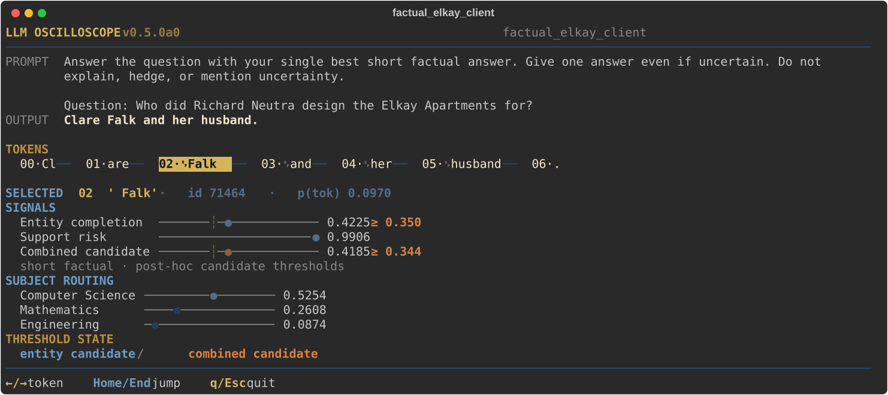

<p align="center">
  
</p>

# RuxyTrace · LLM-Oscilloscope

RuxyTrace makes a few internal LLM signals visible while the model generates text. Small probes read the model's hidden states and turn them into readings you can inspect after each token.

The goal is to make what we learn about one model useful for understanding another. RuxyTrace provides the measurements for this research. It helps read internal signals, test which readings transfer between models, and investigate what the similarities and differences mean. This repo is the current prototype, with code, weights, recorded examples and evaluation outputs.

**This is a research preview.** The strongest evidence covers short English factual answers. The readings can be wrong, and they are not ready for deployment.

## Try it

Start with the recorded Qwen2.5-7B-Instruct examples. You need Python 3.10 or newer.

```bash
git clone https://github.com/pioborgelt/llm-oscilloscope.git
cd llm-oscilloscope
python -m venv .venv
source .venv/bin/activate
python -m pip install -e .

llmosci samples
llmosci demo biology_mitochondria
```

`samples` lists 18 recordings. `demo` opens a token explorer with a small graph across the answer. Use Left/Right to inspect tokens and Up/Down to switch signals. During live generation, the Combined graph grows with the answer.

For live generation, hardware requirements and saving your own traces, follow the [CLI guide](docs/CLI.md).

## What am I looking at?

The default live view shows four readings:

| Reading | What it measures |
|---|---|
| Entity completion | Has the model just finished a factual entity, such as a person's name? |
| Support | Does that completed entity look unsupported? |
| Combined | Completion × support risk, so the support signal matters most at entity endings |
| Subject routing | Which of eight academic subject directions scores highest? |

The detector reads the state **after** a token has been generated. It can flag a completed entity for inspection. Unfortunately, the model does not wait for the warning.

<p align="center">
  
</p>

<p align="center"><em>A recorded Qwen example: the model answers “Clare Falk and her husband” instead of “Louis Kievman.” The Combined score crosses a candidate threshold chosen in a post-hoc analysis.</em></p>

## Where do the probes come from?

I trained the current detector and subject heads myself, building on existing research.

The entity detector builds on work on [detecting hallucinated entities](docs/entity_support_detector/ENTITY_COMPLETION.md#relation-to-existing-work), using the paper's code and weights as comparison controls. My addition is a separate completion probe, to wait until the full name is there before judging it.

The original detector was trained on short factual answers from Llama-3.1-8B-Instruct, with entity spans aligned to tokens and support labels agreed on by two LLM judges. The [method](docs/entity_support_detector/METHOD.md) and [support notes](docs/entity_support_detector/SUPPORT_CHECKING.md) explain the details.

The CLI runs Qwen2.5-7B-Instruct. Completion uses a [transfer adapter](docs/QWEN_NATIVE_TRANSFER.md). Support V2 was trained on labeled Qwen generations. Llama and Qwen have separate evaluations.

[Subject routing](docs/channels/SUBJECT_ROUTING.md) builds on research into linearly separable subject representations. I trained it on academic questions in Llama and transferred it to Qwen and Mistral without subject labels from those models.

## AI Safety

I want to understand why models sometimes give up a correct answer when a user pushes back, and how that differs from accepting good evidence. If we can explain this in one model, does that explanation help predict what another model will do?

Similar probe scores are a clue. Testing the explanation means changing the relevant internal activity, checking how the answer changes, and repeating the experiment on other models. The aim is to use those findings to choose better safety tests and eventually evaluate targeted interventions. The current channels are starting points for this research; transferring a reading does not establish a shared mechanism or a safety guarantee.

## What still needs work?

See the [Issues tab](https://github.com/pioborgelt/llm-oscilloscope/issues) for open questions and next steps.

I'm developing RuxyTrace as a tool for this comparative research. Long term, each study should make the next model easier to investigate. Reusable probes, shared experiments and eventually automatic setup on new models would help build that knowledge over time. The [current results](docs/entity_support_detector/RESULTS.md) and [limitations](docs/LIMITATIONS.md) show where things stand today.

## Read the documentation

| Document | What you'll find |
|---|---|
| [CLI guide](docs/CLI.md) | Installation, hardware requirements, recorded demos, live generation and traces |
| [Limitations](docs/LIMITATIONS.md) | What the current evidence does and doesn't cover |
| [Detector method](docs/entity_support_detector/METHOD.md) | How the completion and support probes work together |
| [Entity completion](docs/entity_support_detector/ENTITY_COMPLETION.md) | Finding the token where a factual entity ends |
| [Support checking](docs/entity_support_detector/SUPPORT_CHECKING.md) | Training the support probe and testing a higher-recall candidate |
| [Evaluation](docs/entity_support_detector/EVALUATION.md) | Data splits, controls and false alarms |
| [Detector results](docs/entity_support_detector/RESULTS.md) | Detailed results and operating points for the Llama detector |
| [Entity-completion results](docs/entity_support_detector/ENTITY_COMPLETION_RESULTS.md) | Comparing support readings at the first, last and highest-scoring entity token |
| [Transfer to Qwen](docs/QWEN_NATIVE_TRANSFER.md) | Moving the original detector channels to Qwen and where transfer breaks down |
| [Subject routing](docs/channels/SUBJECT_ROUTING.md) | Eight academic subject signals and their transfer between models |
| [Positive appraisal](docs/channels/POSITIVE_APPRAISAL.md) | An experimental reading of positive language, not a general sycophancy detector |
| [Retrieval timing](docs/channels/RETRIEVAL_TIMING.md) | Research on factual retrieval timing; not a released CLI channel |
| [Intervention experiment](docs/INTERVENTION_POC.md) | An early steering test, including its failed primary result |
| [Data availability](docs/DATA_AVAILABILITY.md) | Included weights, predictions and recordings, and what's left out |
| [Artifact terms](ARTIFACT_TERMS.md) | Conditions for using and redistributing the model-derived files |

## Verify the package

After installation, run these checks on CPU:

```bash
python scripts/verify_results.py
python -m unittest discover -s tests -q
```

These checks recompute the packaged metrics from saved predictions. Large activation caches are not included. See [data availability](docs/DATA_AVAILABILITY.md), [artifact terms](ARTIFACT_TERMS.md) and the checksums in `MANIFEST.sha256`.

## Get involved

Have a probe you'd like to try here, a safety question to test across models, or an example where the readings make no sense? [Open an issue](https://github.com/pioborgelt/llm-oscilloscope/issues).

A $20,000 Emergent Ventures grant funded the initial detector work. I'm looking for research collaborators, compute and funding to pursue this research and keep developing [RuxyTrace](https://ruxytrace.com) as a tool others can use.

Built with Llama.
